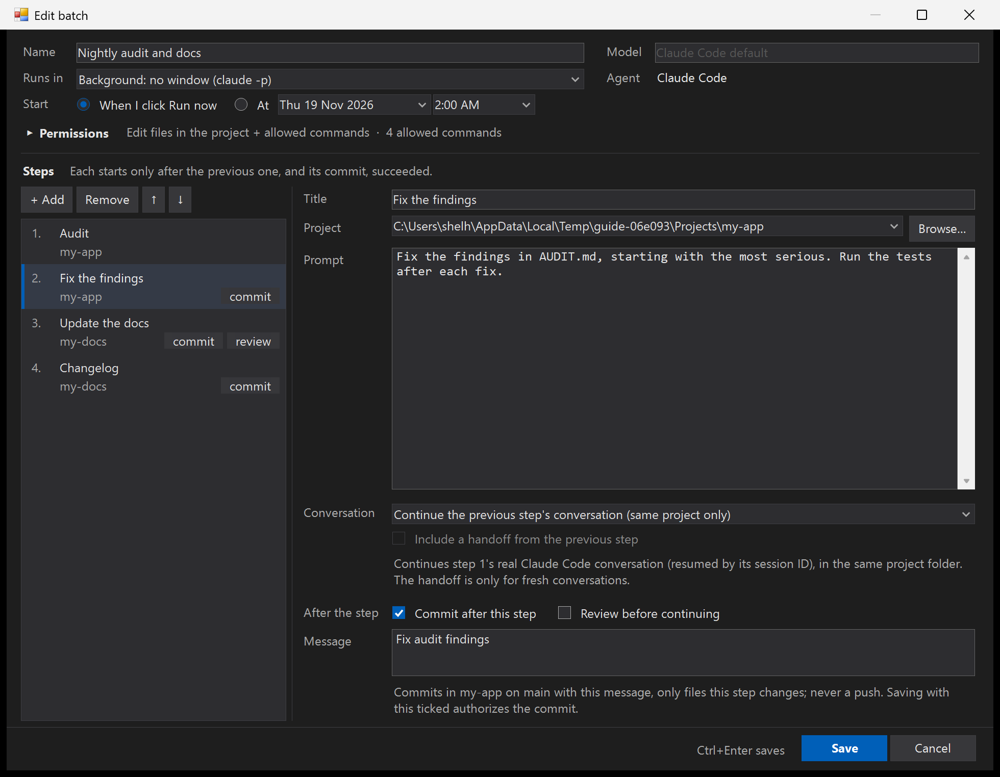
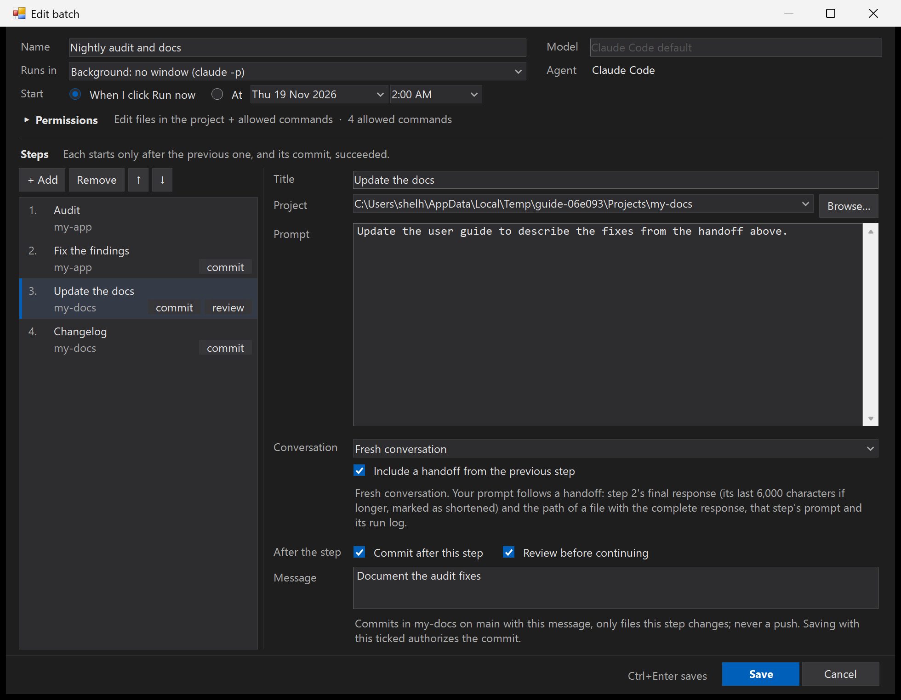
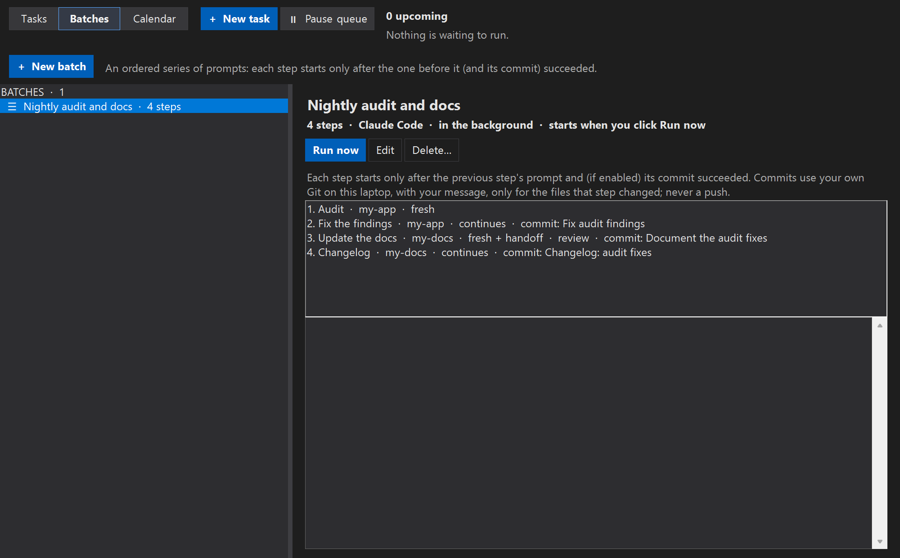
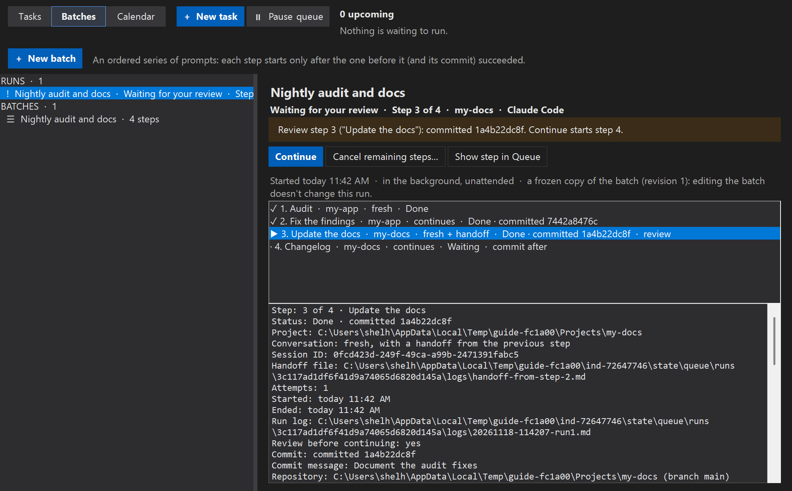
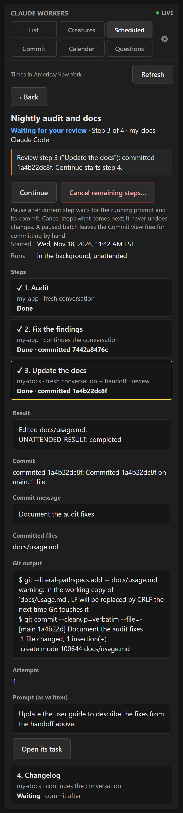
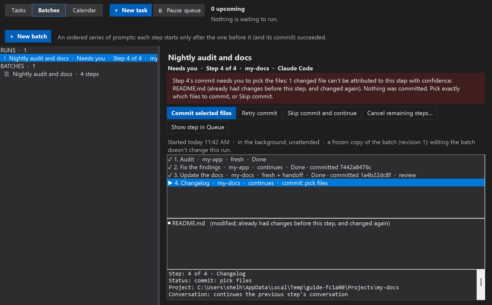
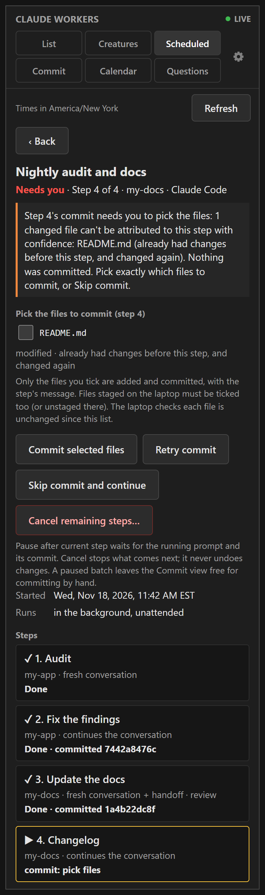
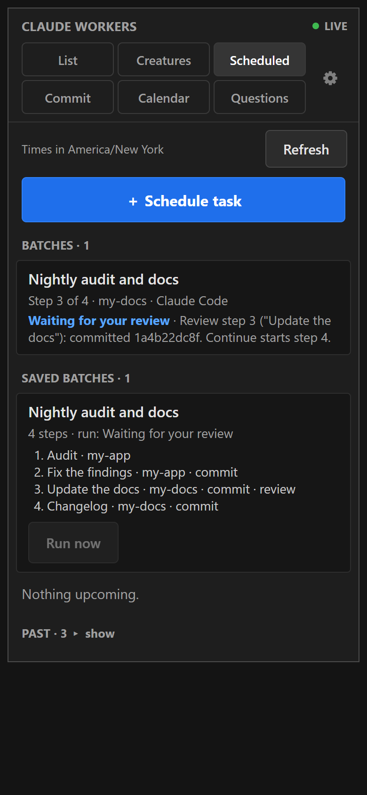

# Batches: a guide with screenshots

Put several prompts in order, start them once, and let Claude Status run them one after another on your laptop, committing between steps if you want. You follow along and step in from the laptop or your phone.

Example: **Audit → Fix the findings → *commit* → Update the docs → *commit* → *review* → Changelog → *commit***

Each step starts only after the step before it, *and its commit*, finished successfully. If anything goes wrong, the batch pauses and tells you why instead of carrying on.

> The screenshots come from a demo setup: two throwaway repositories and a simulated Claude, so file names and results are examples. The full reference is the [Batches section of the main README](../../README.md#batches-a-series-of-prompts-one-after-another).

## 1. Create a batch

1. Open the Queue window (the ☰◷ icon on the Status board) and click the **Batches** tab.
2. Click **+ New batch** and give it a name.
3. The settings at the top apply to every step: where it runs (each project's VS Code window, or the background), what Claude may do and allowed commands (folded under **Permissions**) and model. Every step runs **unattended**: Claude decides routine questions itself and writes each decision into that step's run log.
4. Choose **Start**: *When I click Run now*, or *At* a date and time.
5. Add steps with **+ Add** and order them with **↑** / **↓** (or Alt+Up / Alt+Down in the list). Select a step in the list to edit its title, project, prompt and options.
6. Click **Save**.

*Step 2 continues step 1's conversation in the same project, and commits its changes with the message "Fix audit findings".*

### Continue the conversation, or start fresh

**Continue the previous step's conversation** resumes the exact Claude Code session of the step before, so Claude remembers what it just did. That only works in **the same project folder**: a Claude Code conversation belongs to one folder. The editor warns you, and the batch won't start, if a continued step switches projects.

When a step moves to another project, choose **Fresh conversation** and tick **Include a handoff from the previous step**. The new step's prompt then starts with a visible block: which step and project it came from, that step's final answer (the last 6,000 characters if it's long, marked as shortened), and the path of a file with the full answer, prompt and run log. Your own prompt follows unchanged.

*Step 3 switches to the my-docs project: fresh conversation plus a handoff, a review pause, and a commit.*

Step 1 starts a fresh conversation. It can also continue an existing conversation of its project that you pick from the list, like a single scheduled task.

## 2. Start it

Select the saved batch and click **Run now**, or let its start time arrive. Claude Status must be running (minimized to the tray is fine). Running a batch again later creates a new run with fresh progress; earlier runs stay under History.

Once a run starts it uses a frozen copy of the batch. Editing the batch afterwards changes the next run, never the one in progress.

## 3. Follow it and review

The run shows its status, *Step 3 of 4*, the current project, and every step with its result and commit. Select a step to see its prompt, result, session, run log and Git output. Each step also appears as a normal task in the Queue and on the Status board while it works.

With **Review before continuing** ticked, the batch stops after that step (and its commit) and waits for **Continue**.

*Laptop: waiting for your review after step 3, which already committed.*

*Phone: the same run, with step 3 opened.*

## 4. Commits between steps

Tick **Commit after this step** and write the message. Saving the batch authorizes that commit; you aren't asked again each time.

- Claude Status commits with **your own Git** on the laptop, the same way the phone's Commit view does, using exactly your message. Nothing is added to it: no Claude attribution or watermark. Your author, hooks and signing apply as usual. It never pushes.
- It commits **only the files that changed during that step**. Files you had already changed before the step are left alone.
- If nothing changed, it notes *No changes to commit* and carries on.

When it can't tell for sure which changes belong to the step (a file you were already editing that the step changed again, something you had staged, a change outside the step's folder), it commits nothing and asks you to pick the files.

*Laptop: README.md was already edited before step 4, so the batch asks before committing it.*

*Phone: tick the files, then Commit selected files.*

> Want to look at changes *before* they're committed? Leave **Commit after this step** off, tick **Review before continuing**, and commit by hand in the phone's Commit view while the batch waits. An automatic commit happens before the review pause, not after.

## 5. From your phone

Open the dashboard and go to **Scheduled**. Batches are at the top: running ones, your saved batches with **Run now**, and past runs. Tap a run to see its steps and act on it. You create and edit batches on the laptop.

The phone shows only the buttons the laptop allows right now, and changes appear only after the laptop confirms them. A double tap or an old page can't do anything twice: the laptop checks each action against the run's current state. If your phone disconnects, the batch keeps running.

## 6. When it pauses

A step only counts as done when Claude finishes and confirms it completed. Everything else pauses the batch, and nothing after it starts.

| You see | What happened | What you can do |
|---|---|---|
| Needs you | The step failed, needs a permission or input, or was interrupted. | **Retry step** (continues that step's conversation), **Skip step…**, **Cancel remaining steps…** |
| Result unclear | Claude stopped without confirming it finished. | Read the result, then **Accept result and continue**, Retry, Skip or Cancel. |
| Commit failed | For example a Git hook rejected it. Git's output is shown. | **Retry commit** (doesn't rerun the prompt), **Skip commit and continue**, Cancel. |
| Waiting for usage | You hit a usage limit. | Nothing: the step continues after the reset. |
| Paused | You pressed **Pause after current step**. | **Resume**. |
| Waiting for your review | A review checkpoint. | **Continue**. |

**Pause after current step** lets the running step and its commit finish first. **Cancel remaining steps…** stops anything further from starting; a prompt that is already running keeps going unless you also use **Stop current prompt…**. Nothing is ever rolled back: file changes and commits stay.

If the laptop restarts mid-batch, finished steps are never repeated. A step that was running is picked up again; if its outcome can't be known, the batch pauses instead of running it twice. An interrupted commit is checked against Git history before anything is retried.

## 7. Good to know

- One batch runs at a time; another one that's due waits for it.
- A single scheduled task in the same repository waits until the batch's step and its commit are done, so its changes never end up in the batch's commit.
- Batches use Claude Code only.
- Try your first batch on a throwaway Git folder with two small steps before using it on a real project.
